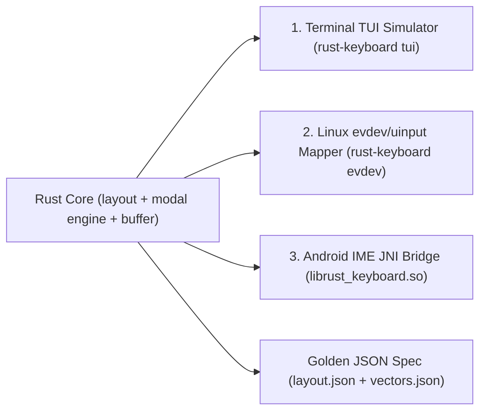

# `rust-keyboard` — Tactical Rust Keyboard Engine & Package (`arm64`)

> **Zero external dependencies. Offline by design. Dvorak + Programmer Dvorak + QWERTY + Neovim Modal Engine + TUI + Linux `evdev` + Android JNI.**

---

## 1. Architecture & Three Operational Surfaces



1. **Terminal TUI & Modal Engine (`rust-keyboard tui` / `play`)**
   - Full ANSI keyboard visualizer displaying active Profile (`DVORAK`, `PROG-DVORAK`, `QWERTY`), Mode (`INSERT`, `NORMAL`), Layer (`ALPHA`, `SYMBOL`), Shift (`OFF`, `ONCE`, `CAPS LOCK`), and live text buffer with cursor and undo stack.
   - Neovim-style Normal mode: `hjkl`, `w`/`e`/`b`, `0`/`^`/`$`, `x`/`X`, `u`, `i`/`a`/`I`/`A`/`o`/`O`, plus operator-pending `dd`, `dw`, `cw`, `cc`.
2. **Linux `evdev` / `uinput` Hardware Keymapper (`rust-keyboard evdev`)**
   - Translates physical Linux `input-event-codes.h` scancodes (`KEY_Q`..`KEY_M`, `KEY_CAPSLOCK` -> `NAV`) to Dvorak / Programmer Dvorak actions.
   - Supports `--table` inspection, `--sim <KEY_...>` simulation in unprivileged PRoot containers, and `--device /dev/input/eventX` hardware listener.
3. **Android IME / C-ABI & JNI Bridge (`rust-keyboard jni` & `librust_keyboard.so`)**
   - Compiles to both `/usr/bin/rust-keyboard` and `/usr/lib/librust_keyboard.so` (`cdylib`).
   - Exports `rkb_engine_new`, `rkb_engine_press`, `rkb_engine_free`, and generates the Kotlin `InputMethodService` + C header (`librust_keyboard.h`).

---

## 2. Usage

```bash
# 1. Render TUI Keyboard Visualizer (one-shot or interactive REPL)
rust-keyboard tui --once SHIFT h e l l o SPACE NAV b d w i SHIFT r u s t
rust-keyboard tui

# 2. Linux evdev scancode table & hardware event simulation
rust-keyboard evdev --table
rust-keyboard evdev --sim KEY_LEFTSHIFT KEY_J KEY_D KEY_P KEY_P KEY_S KEY_CAPSLOCK KEY_H KEY_X

# 3. Verify Android JNI / C-ABI FFI bridge & emit Kotlin IME / C header scaffolds
rust-keyboard jni --verify
rust-keyboard jni --emit-dir ./android-jni

# 4. Generate golden JSON layout & test vectors
rust-keyboard spec --write ./spec
```

---

## 3. Debian Package (`.deb`)

Built via `dpkg-deb --build` and installed system-wide:
- Binary: `/usr/bin/rust-keyboard` (plus Termux symlink `/data/data/com.termux/files/usr/bin/rust-keyboard` & `/data/data/com.termux/files/home/ops/bin/rust-keyboard`)
- Shared Library: `/usr/lib/librust_keyboard.so`
- C Header: `/usr/include/librust_keyboard.h`
- Spec & Android Scaffolds: `/usr/share/rust-keyboard/`
